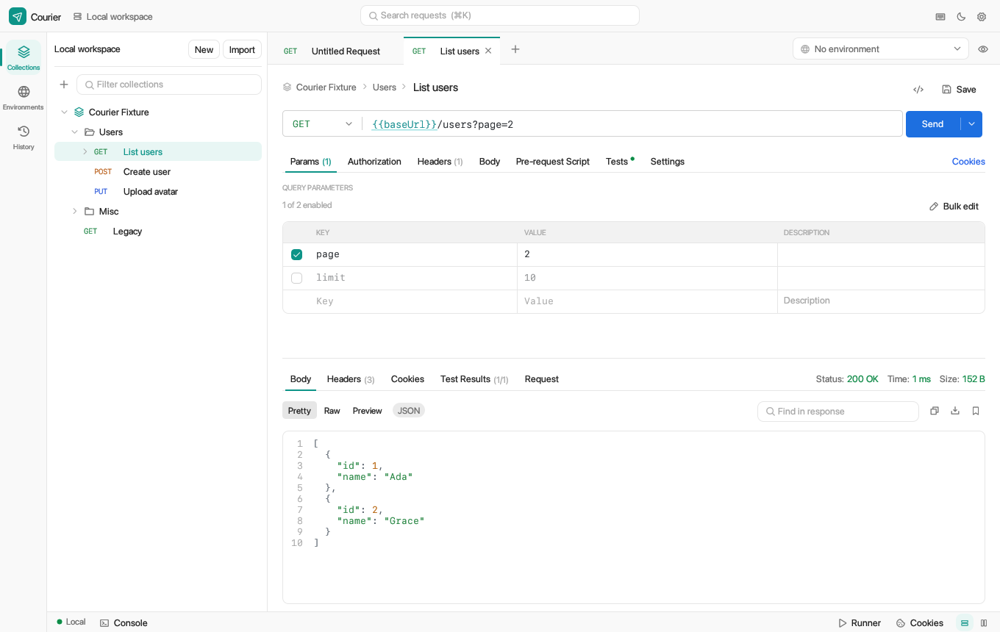
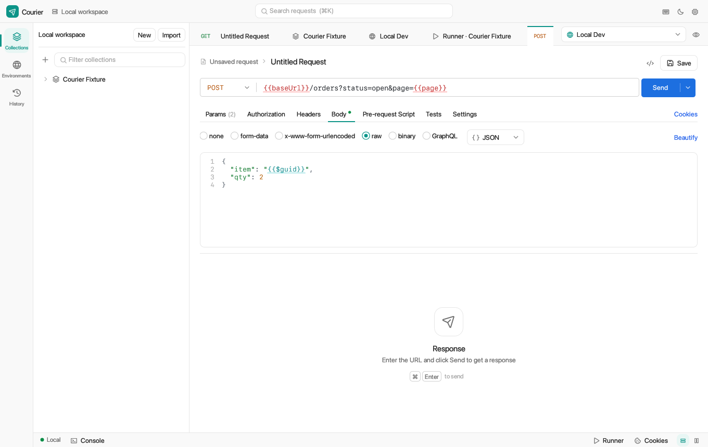
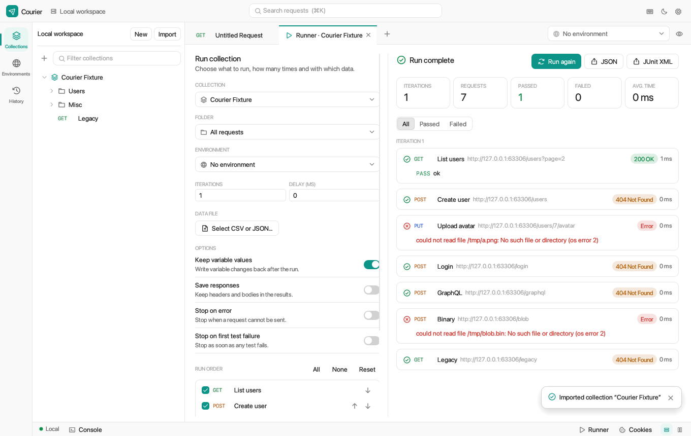
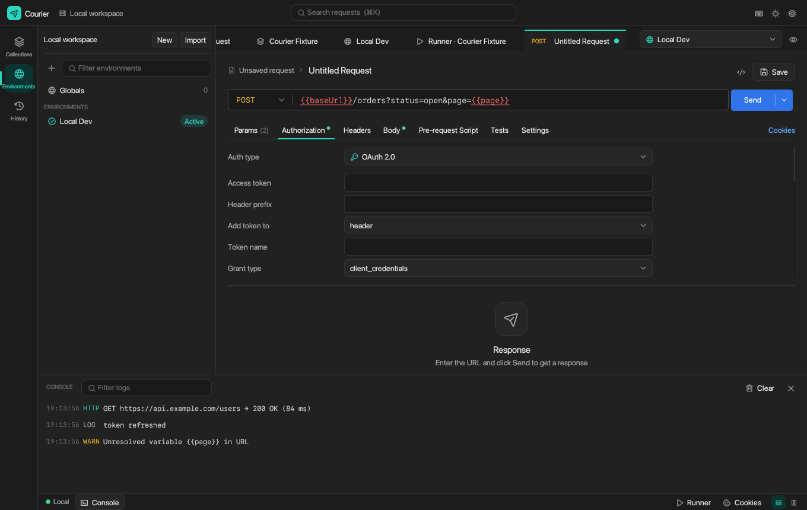

# Courier

A local-first desktop API client for **macOS**, **Linux** (Ubuntu and other distributions) and **Windows**, written in Rust with egui, reqwest and tokio. There are no accounts and no cloud; everything is stored as JSON on your machine. See [SPEC.md](SPEC.md) for the full specification.

The layout will feel familiar if you have used Postman: collections on the left, request tabs across the top, and Params, Authorization, Headers, Body, Pre-request Script, Tests and Settings above the response. Courier starts in a light theme, and dark mode is one click away (the moon icon at the top right).



| Body editor | Collection runner | Dark mode |
|---|---|---|
|  |  |  |

## Install

**[Download the one-page quick start (PDF)](docs/Courier-Quick-Start.pdf)** to share with friends: it has the install commands, a 2-minute walkthrough and shortcuts.

Pick your platform. There are two ways on each: download a ready-made installer from [Releases](https://github.com/ambujraj2001/Courier/releases), or build from source after cloning.

### macOS

**Option A: download.** Get `Courier-macos-arm64.dmg` (Apple Silicon, M1 and later) or `Courier-macos-x86_64.dmg` (Intel) from [Releases](https://github.com/ambujraj2001/Courier/releases). Open it and drag **Courier** into **Applications**.

The app is not notarized by Apple, so the first launch is blocked. Allow it once with either of these:

- Open **System Settings → Privacy & Security**, scroll down and click **Open Anyway** next to Courier.
- Or run this in Terminal:

```bash
xattr -dr com.apple.quarantine /Applications/Courier.app
```

**Option B: build from source.** You need the Xcode Command Line Tools and Rust:

```bash
xcode-select --install
```

```bash
curl --proto '=https' --tlsv1.2 -sSf https://sh.rustup.rs | sh
```

Then clone and install. The script builds Courier, signs it for your Mac and copies it to `/Applications`:

```bash
git clone https://github.com/ambujraj2001/Courier.git && cd Courier && ./scripts/install-macos.sh
```

Use `./scripts/install-macos.sh --user` to install into `~/Applications` instead. Open Courier from Launchpad or Spotlight.

### Linux (Ubuntu, Debian and others)

**Option A: one command** (Ubuntu 22.04 or newer, Debian 12 or newer, 64-bit Intel/AMD). This downloads the latest `.deb` from [Releases](https://github.com/ambujraj2001/Courier/releases), installs it and opens Courier:

```bash
wget -O /tmp/courier.deb https://github.com/ambujraj2001/Courier/releases/latest/download/courier_amd64.deb && sudo apt install -y /tmp/courier.deb && courier
```

Run the same command again later to update.

Courier appears in your applications menu. You can also start it with `courier`. To remove it:

```bash
sudo apt remove courier
```

**Option B: build from source.** This works on Ubuntu, Debian and most other distributions, including ARM machines. Clone the repo, then run the installer with `--install-deps` so it can `apt-get` the compiler and libraries:

```bash
git clone https://github.com/ambujraj2001/Courier.git && cd Courier
```

```bash
curl --proto '=https' --tlsv1.2 -sSf https://sh.rustup.rs | sh && source "$HOME/.cargo/env"
```

```bash
./scripts/install-linux.sh --install-deps
```

This installs Courier for your user only, without root: the program goes in `~/.local/bin/courier`, plus a menu entry and icons. The first build takes a few minutes. To remove it:

```bash
./scripts/uninstall-linux.sh
```

On a distribution without `apt-get`, install a C compiler, `pkg-config`, and the X11, Wayland, xkbcommon and OpenGL development packages yourself. Then run `./scripts/install-linux.sh` without `--install-deps`.

To build your own `.deb` instead:

```bash
./scripts/build-deb.sh
```

```bash
sudo apt install ./target/release/bundle/deb/courier_*_amd64.deb
```

### Windows

**Option A: one command.** In PowerShell, this downloads `Courier.exe` to your Desktop and opens it. It is a single self-contained program for Windows 10 and 11 (64-bit), so there is nothing to install:

```powershell
iwr https://github.com/ambujraj2001/Courier/releases/latest/download/Courier-windows-x86_64.exe -OutFile "$env:USERPROFILE\Desktop\Courier.exe"; Start-Process "$env:USERPROFILE\Desktop\Courier.exe"
```

You can also download `Courier-windows-x86_64.exe` from [Releases](https://github.com/ambujraj2001/Courier/releases) and double-click it.

The `.exe` is not code-signed, so Windows SmartScreen may say "Windows protected your PC". Click **More info → Run anyway**. This happens only the first time.

**Option B: build from source.** Install [Rust](https://rustup.rs). When the Rust installer asks, also install the Visual Studio C++ Build Tools. Then, in PowerShell:

```powershell
git clone https://github.com/ambujraj2001/Courier.git; cd Courier; cargo build --release
```

The program is at `target\release\courier.exe`.

### Try it

1. Press `⌘T` on macOS, or `Ctrl+T` on Linux and Windows, to open a new request.
2. Paste this into the URL bar. It becomes a full request:

   ```bash
   curl https://jsonplaceholder.typicode.com/posts -H 'Content-Type: application/json' -d '{"title":"Hello from Courier","userId":1}'
   ```

3. Press `⌘Enter` (or `Ctrl+Enter`) to send it.

Press `⌘O` (or `Ctrl+O`) to import a Postman collection or environment.

## Features

- HTTP requests with any method: query and path parameters, headers, and six body modes (none, form-data, x-www-form-urlencoded, raw JSON/XML/HTML/JS/text, binary, GraphQL)
- Authorization: API key, Bearer, Basic, Digest, OAuth 1.0, OAuth 2.0 (client credentials, password, authorization code with PKCE, implicit, refresh), JWT, Hawk and AWS Signature v4, inherited from collections and folders
- `{{variables}}` with local, data, environment, collection and global scopes, plus 43 dynamic `{{$…}}` variables
- Collections, folders and saved examples, with drag-and-drop ordering
- Environments with initial and current values, secret variables, and a global variable set
- Request history grouped by day, with search
- JavaScript pre-request and post-response scripts with a `pm` API, BDD-style assertions, JSON Schema checks and `pm.sendRequest`
- A collection runner with iterations, CSV/JSON data files, `setNextRequest`, pause and stop, and JUnit export
- Import and export of Postman Collection v2.1 (v2.0 import too), environment and globals files, and cURL commands; raw HTTP snippets; full Courier backups
- A cookie jar, proxy settings, custom CA and client certificates, and response size limits

## Data location

| Platform | Folder |
|---|---|
| macOS | `~/Library/Application Support/Courier/` |
| Linux | `~/.local/share/Courier/` (or `$XDG_DATA_HOME/Courier/`) |
| Windows | `%APPDATA%\Courier\` |

Set `COURIER_DATA_DIR` to use a different folder. Files are written atomically with `0600` permissions. If a file is corrupt, it is moved aside rather than deleted. Uninstalling Courier leaves this folder in place.

## Develop

```bash
cargo run
```

```bash
cargo test
```

```bash
cargo clippy --all-targets -- -D warnings
```

The UI tests drive the real app without opening a window. To also save PNG renders of the main screens, set `COURIER_SNAPSHOT_DIR` (this needs a GPU):

```bash
COURIER_SNAPSHOT_DIR=/tmp/courier-snapshots cargo test --test ui
```

On Linux, install the build dependencies first, either with `./scripts/install-linux.sh --install-deps` or with the `apt-get` line in that script.

## Releases and CI

- **CI:** every push to `main` runs [CI](.github/workflows/ci.yml). On Ubuntu 22.04 it runs format, clippy and the tests, builds the `.deb` and checks that it installs. On macOS it runs the tests and builds `Courier.app`. On Windows it runs the tests and builds `Courier.exe`. The packages are attached to each run as artifacts.
- **Releases:** pushing a version tag runs [Release](.github/workflows/release.yml). It builds the `.deb`, both macOS DMGs and the Windows `.exe`, and publishes them as a GitHub release:

```bash
git tag v0.2.0 && git push origin v0.2.0
```

The macOS builds are signed ad hoc. Notarized builds need an Apple Developer ID.

The icon PNGs in `assets/icon/` are generated from code:

```bash
cargo run --example make_icon
```

## Layout

| Path | Contents |
|---|---|
| `src/model` | Collections, requests, auth, variables, URL/query sync |
| `src/vars` | Variable scopes, `{{}}` resolution, dynamic variables |
| `src/http` | Request preparation and the reqwest-based sender |
| `src/auth` | Signers and OAuth 2.0 flows |
| `src/script` | QuickJS sandbox and the `pm` API (`prelude.js`) |
| `src/exec.rs`, `src/runner.rs`, `src/history.rs` | Execution, collection runs, history |
| `src/formats` | Postman v2.1/v2.0, cURL, snippets, import detection |
| `src/storage.rs`, `src/settings.rs`, `src/cookies.rs` | Local storage, settings, cookie jar |
| `src/app` | The egui interface (`platform.rs` holds the macOS/Linux/Windows differences) |
| `scripts/` | Install, uninstall and packaging scripts |
| `packaging/linux/` | Linux desktop entry |
| `build.rs`, `.cargo/config.toml` | Windows icon and a self-contained `.exe` |
| `.github/workflows/` | CI and release builds |
